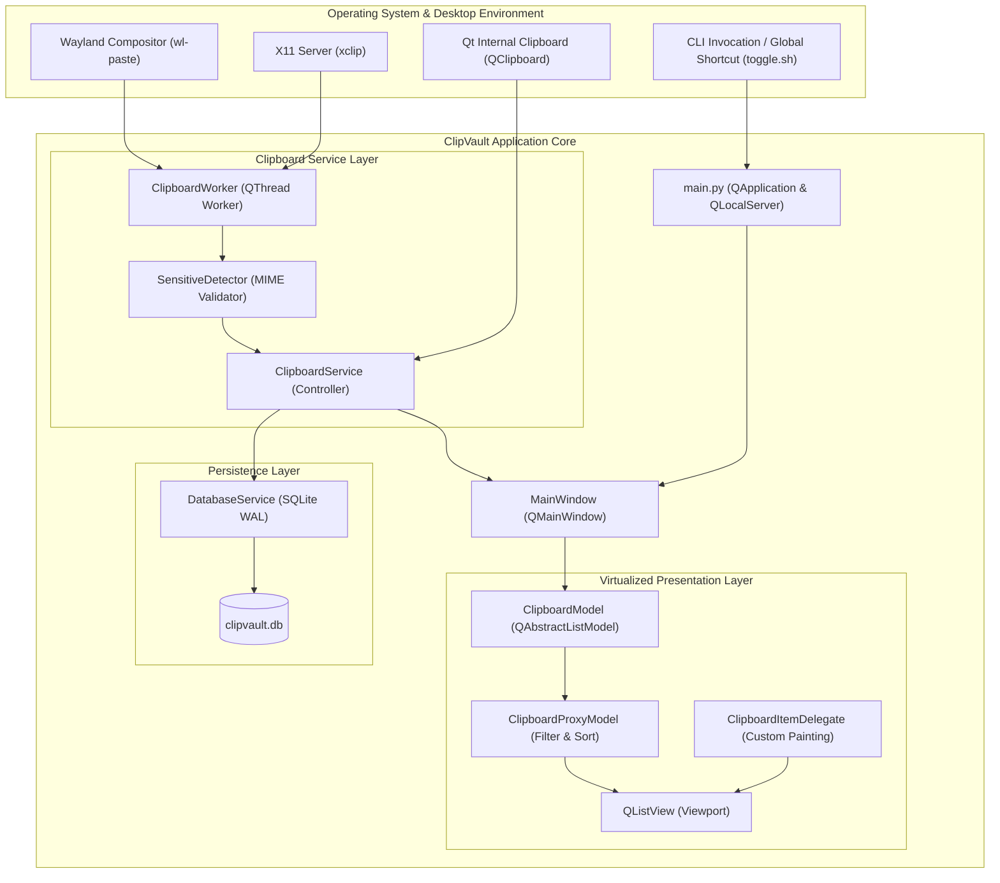
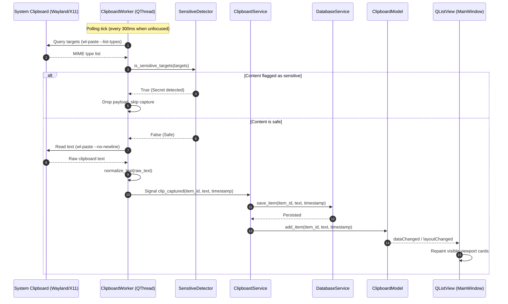

# ClipVault Architecture Specification

This document details the system design, component boundaries, concurrency model, and future extensibility blueprints for ClipVault, an Ubuntu clipboard manager optimized for Wayland and X11 environments.

## 1. System Overview

ClipVault captures, categorizes, stores, and presents clipboard history while protecting sensitive user data (such as passwords from KeePassXC, Bitwarden, and 1Password). It solves Wayland clipboard isolation restrictions using an asynchronous three-tier polling engine and provides fluid UI interactions through a virtualized Model-View-Delegate architecture.



## 2. Core Architectural Components

### Application Entry Point and Single-Instance IPC (`main.py`)
*   **Single-instance locking:** Uses `QLocalSocket` to connect to `ClipVaultLocalServer`. If a connection succeeds, the running instance is already active; the CLI sends `toggle\n` to focus or hide the window and terminates immediately.
*   **IPC server:** If no instance exists, `main.py` binds a `QLocalServer` named `ClipVaultLocalServer` to listen for toggle triggers from external scripts, keyboard shortcuts, or application launchers.
*   **Startup lifecycle:** Initializes `QApplication`, applies the dark stylesheet, instantiates `MainWindow`, and starts the Qt event loop.

### Three-Tier Clipboard Service (`services/clipboard_service.py`)
Standard Qt clipboard signals do not trigger on Wayland when the application window is unfocused due to Wayland security boundaries. ClipVault solves this through three coordinated tiers:

*   **Tier 1 (Off-thread background worker):** When the window is unfocused, `ClipboardWorker` runs on a dedicated `QThread`. It polls external utilities (`wl-paste` on Wayland, `xclip` on X11) every 300 milliseconds. Subprocess execution happens entirely off the main thread to prevent UI freezing and dock flickering.
*   **Tier 2 (Focus-aware execution):** When `MainWindow` gains focus, the background polling thread pauses completely (0% CPU overhead). While focused, clipboard events are captured instantly through standard Qt events.
*   **Tier 3 (Qt fallback):** While the application is focused, standard `QClipboard.dataChanged` signals capture copy events instantly with zero subprocess overhead.
*   **Copy-back loop prevention:** When an item is selected from history and written back to the system clipboard, an internal `_ignore_next` flag suppresses self-capture.

### Sensitive Data Detection (`services/sensitive_detector.py`)
*   **MIME hint interception:** Prior to reading text, the worker inspects clipboard target types using `wl-paste --list-types` or `xclip -selection clipboard -t TARGETS`.
*   **Password manager recognition:** Recognizes standard security hints from KeePassXC, 1Password, Bitwarden, and KWallet, including `x-kde-passwordManagerHint`, `application/x-password-manager-hint`, `application/x-copyq-secret`, and `application/x-nspasteboard-concealed-type`.
*   **Negative indicator support:** Verifies that hints are not explicitly disabled (for example, values set to `0` or `false`).
*   **Zero-retention guarantee:** Flagged sensitive payloads are dropped immediately without touching memory history or disk storage.

### Virtualized Presentation Layer (`ui/`)
ClipVault avoids allocating individual `QWidget` objects for every clipboard entry. Instead, it utilizes Qt Model-View-Delegate virtualization:

*   **Model (`ui/clipboard_model.py`):** `ClipboardModel` inherits `QAbstractListModel`. It maintains an in-memory collection of dictionary items exposing custom data roles: `ItemIdRole`, `FullTextRole`, `TimestampRole`, `PinnedRole`, `PreviewTextRole`, and `LineCountRole`.
*   **Proxy filtering (`ui/clipboard_model.py`):** `ClipboardProxyModel` inherits `QSortFilterProxyModel`. It handles case-insensitive substring searching without reallocating item rows, sorting pinned cards to the top, followed by reverse chronological order.
*   **Delegate rendering (`ui/clipboard_delegate.py`):** `ClipboardItemDelegate` inherits `QStyledItemDelegate`. It executes direct `QPainter` drawing passes for visible cards only, dynamically applying theme palettes (`dark` and `light`) to keep memory consumption constant regardless of history size.
*   **Main window (`ui/main_window.py`):** Manages window layout, search bar input, list viewport, status bar counters, theme toggle controls (persisted via `QSettings`), and keyboard navigation (Down Arrow focus shift, Delete key item purging, and Escape window dismissal).
*   **Dual-theme styling engine (`ui/styles.py`):** Defines `DARK_THEME` and `LIGHT_THEME` stylesheets alongside structured `DELEGATE_PALETTES` providing high-contrast background, border, text, and button states across light and dark modes.

### Persistence Service (`services/database_service.py`)
*   **Storage engine:** Embedded SQLite database (`clipvault.db`).
*   **Write-Ahead Logging (WAL):** Configured with `PRAGMA journal_mode=WAL;` and `PRAGMA synchronous=NORMAL;` to permit concurrent reader queries alongside background writer commits.
*   **Snap container awareness:** Detects the `$SNAP_USER_DATA` environment variable to ensure storage complies with Ubuntu strict confinement paths.
*   **Automatic schema migrations:** Verifies column schemas using `PRAGMA table_info` and applies schema extensions (such as adding the `pinned` column) dynamically.
*   **History cap:** Automatically prunes unpinned entries beyond the 100-item history limit while keeping pinned items permanently.

## 3. Data Flow and State Lifecycle



## 4. Concurrency and Thread Safety Rules

Future developers modifying ClipVault must adhere to these concurrency invariants:

*   **GUI thread isolation:** Never execute blocking system calls, file input/output, or subprocess invocations inside the main GUI thread. All external process calls belong in `ClipboardWorker` or dedicated worker threads.
*   **Signal and slot communication:** Never invoke methods on GUI widgets directly from background threads. All cross-thread notifications must use PyQt signals and slots with queued connections.
*   **Database connection boundaries:** SQLite connections cannot be shared across thread boundaries. Open and close connections within short-lived context manager blocks or dedicate separate connection instances per thread.
*   **Timer management:** Timers driving GUI updates (`QTimer`) must belong to the main thread event loop. Timers driving worker polling must belong to the worker thread context.

## 5. Architectural Blueprints for Future Development

### Extension 1: Cross-Device Synchronization
*   **Design goal:** Allow optional peer-to-peer clipboard sharing across local network instances.
*   **Proposed architecture:** Introduce a `SyncService` module running an encrypted WebSocket or libp2p channel.
*   **Security requirement:** Payloads must be encrypted with authenticated end-to-end encryption (AES-256-GCM or ChaCha20-Poly1305) using a shared pairing secret before leaving the host machine.
*   **Isolation rule:** Sensitive items flagged by `SensitiveDetector` must never be serialized or transmitted across the sync interface.

### Extension 2: Full-Text Search with SQLite FTS5
*   **Design goal:** Instant search queries across thousands of historical clips with snippet highlighting.
*   **Proposed architecture:** Replace manual `LIKE %query%` filters with an SQLite FTS5 virtual table (`clipboard_fts`).
*   **Synchronization:** Use SQLite triggers (`AFTER INSERT`, `AFTER UPDATE`, `AFTER DELETE`) on `clipboard_history` to keep the FTS index automatically synchronized with zero Python overhead.

### Extension 3: Global Hotkey Daemon via Desktop Portals
*   **Design goal:** Native global hotkeys on Wayland without relying on external shell script workarounds.
*   **Proposed architecture:** Integrate with the `org.freedesktop.portal.GlobalShortcuts` D-Bus interface.
*   **Fallback:** Maintain `ClipVaultLocalServer` socket handling for backward compatibility with custom desktop environment keyboard shortcuts.

### Extension 4: Encrypted Secret Vault
*   **Design goal:** Allow users to intentionally store credentials in an isolated, encrypted vault requiring biometric or master password authentication.
*   **Proposed architecture:** Introduce a separate `EncryptedVaultService` utilizing SQLCipher or PBKDF2/Argon2 key derivation.
*   **Isolation invariant:** The general clipboard history and the encrypted vault must remain separate database files with distinct encryption keys and memory Lifetimes.

## 6. Directory Structure Blueprint

```text
ubuntu-clipboard-manager/
├── ARCHITECTURE.md                 # System architecture specification
├── SKILLS.md                       # Engineering standards and practices
├── TEST_PLAN.md                    # Comprehensive test strategy and verification matrix
├── main.py                         # Application bootstrap and IPC server
├── clipvault.db                    # Default SQLite storage (WAL mode)
├── requirements.txt                # Python runtime dependencies
├── test_clipboard.sh               # Local test automation runner
├── toggle.sh                       # IPC toggle client
├── .agents/                        # Agent customization and workflow root
│   └── skills/
│       └── clean-code/
│           └── SKILL.md            # Clean, DRY, and secure code skill
├── services/                       # Application business logic and system services
│   ├── __init__.py
│   ├── clipboard_service.py        # Three-tier clipboard monitoring engine
│   ├── database_service.py         # SQLite persistence with WAL mode
│   └── sensitive_detector.py      # MIME hint password manager detector
├── ui/                             # Virtualized Qt presentation layer
│   ├── __init__.py
│   ├── clipboard_delegate.py       # Custom item painter and event handler
│   ├── clipboard_item.py           # Legacy widget fallback
│   ├── clipboard_model.py          # Virtualized list model and proxy filter
│   ├── main_window.py              # Main application window
│   └── styles.py                   # Global dark styling and color palette
├── tests/                          # Automated test suites
│   ├── __init__.py
│   ├── test_database_service.py    # Database schema, WAL, and migration tests
│   ├── test_sensitive_detector.py  # Password manager hint unit tests
│   ├── test_sensitive_clipboard_service.py # Service-level sensitive filtering tests
│   └── test_virtualized_view.py    # Model, proxy, delegate, and GUI tests
└── snap/                           # Snap packaging configuration
    ├── snapcraft.yaml              # Strict confinement recipe
    └── local/                      # Launcher scripts and desktop integration
```

