<p align="center">
  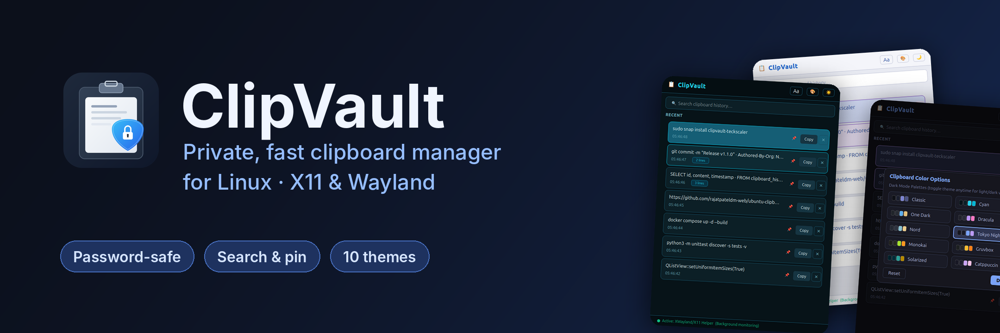
</p>

<h1 align="center">ClipVault</h1>

<p align="center">
  <strong>Privacy-first Linux clipboard manager built with Python and PyQt6 for Wayland and X11 desktops.</strong>
</p>

<p align="center">
  <a href="https://github.com/rajatpateldm-web/ubuntu-clipboard-manager/releases/tag/v1.1.0"></a>
  <a href="https://snapcraft.io/clipvault-teckscaler"></a>
  <a href="LICENSE"></a>
  <a href="https://teckscaler.com/clipvault-clipboard-manager/"></a>
</p>

<p align="center">
  
  
  
  
  
</p>

ClipVault tracks your text clipboard history on Ubuntu, GNOME Wayland, and X11 desktops without leaking credentials, consuming excessive RAM, or flickering your dock. Before reading any copied text payload into memory, ClipVault inspects MIME descriptors and automatically discards secrets flagged by KeePassXC, Bitwarden, 1Password, and KWallet prior to writing to local SQLite WAL storage.

| Live Theme Cycling Across 10 Developer Palettes | Live Font Customization and Dynamic Sizing |
|---|---|
| 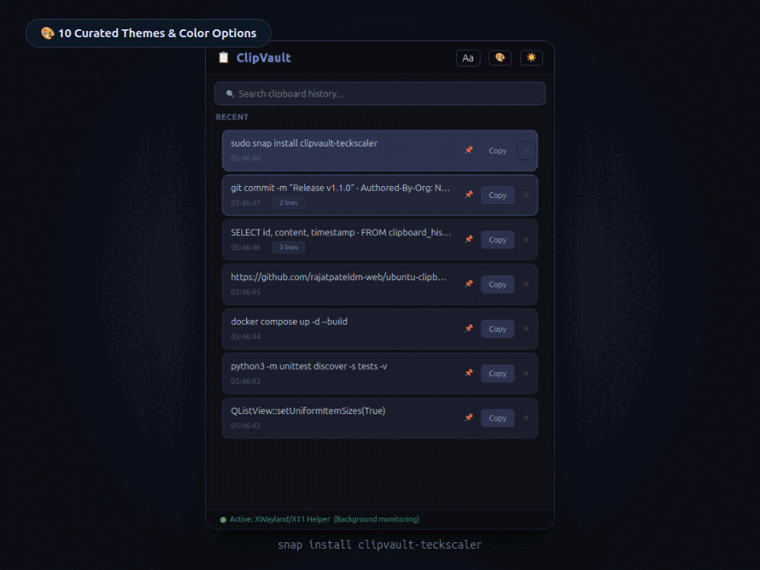 | 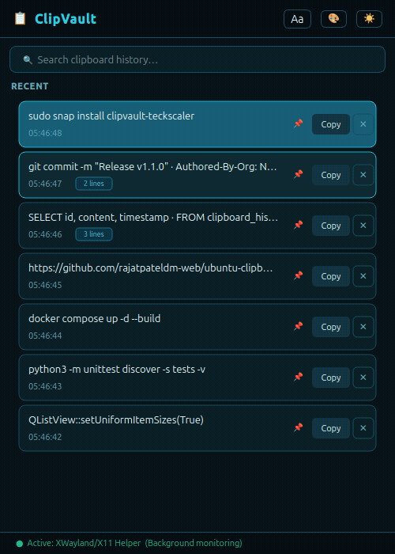 |

## What Is New in Version 1.1.0

The v1.1.0 release delivers comprehensive personalization, native background capture, and security hardening:

- **Typography and Font Customization:** Choose from font family presets (`System Default`, `Ubuntu`, `Sans Serif`, `Monospace`, `Serif`) or installed system fonts via `QFontDatabase`. Adjust font styles (`Regular`, `Bold`, `Italic`, `Bold Italic`) and tune font sizes from `10 px` to `22 px` with real-time preview and dynamic card row scaling.
- **Ten Curated Developer Color Schemes:** Personalize your clipboard manager with 10 themes (`Classic`, `Cyan`, `One Dark`, `Dracula`, `Nord`, `Tokyo Night`, `Monokai`, `Gruvbox`, `Solarized`, `Catppuccin`). Every scheme features tailored Dark and Light mode variants (20 colorway combinations).
- **Centered In-Window Modal Overlays:** Settings dialogs are integrated directly as modal in-window overlays inside the main interface. This keeps dialogs vertically centered, compact, and free from multi-window compositor clipping under GNOME Wayland.
- **Persistent X11 and XWayland Background Helper:** Native clipboard helper (`services/x11_clipboard_helper.py`) captures copy events from external applications even when ClipVault is unfocused and command-line utilities (`xclip`, `xsel`, `wl-paste`) are not installed.
- **Security and Storage Hardening:** Enforced strict `0o600` permissions on SQLite `.db`, `-wal`, and `-shm` files. Added bounded 64-byte IPC command parsing with exact matching, extended copy-back ignore windows to `1200 ms`, and bundled Adwaita and Hicolor icon themes in Snapcraft for crisp Wayland rendering.
- **Expanded Test Suite and Developer Config:** 68 automated unit and integration tests covering font options, color themes, IPC bounds, X11 helper streaming, and database permissions, accompanied by `CONTRIBUTING.md` and `pyproject.toml`.

## Version 1.1.0 Screenshots and Demos

### Modern Interface (Dark and Light Modes)

ClipVault v1.1.0 features a refined interface with instant search, pinned clip management, and one-click copy.

| Dark Mode Window (`1-screenshot-main.png`) | Light Mode Window (`2-screenshot-light.png`) |
|---|---|
| 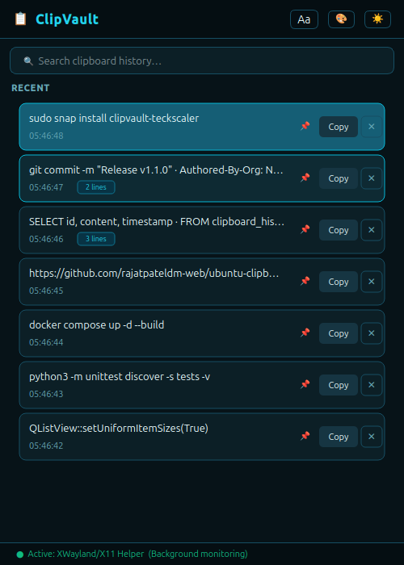 | 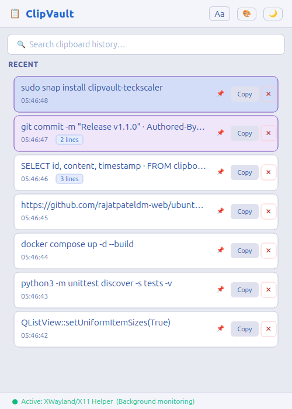 |

<p align="center">
  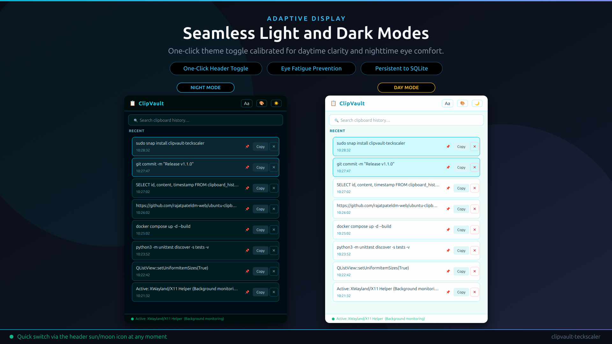
</p>

### In-Window Settings Dialogs

Font and color scheme dialogs are embedded within the main application window to prevent detached floating window bugs on Wayland desktops.

| Color Scheme Dialog (`3-screenshot-colors.png`) | Font Customization Dialog (`4-screenshot-fonts.png`) |
|---|---|
| 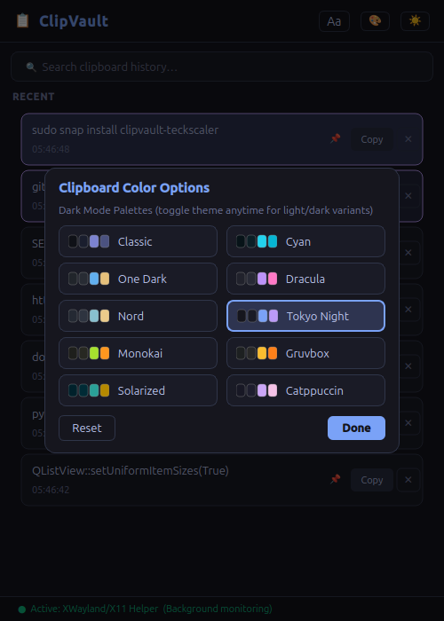 | 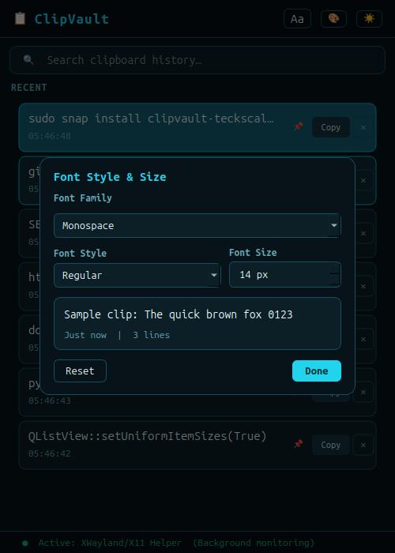 |

### Developer Color Palettes Showcase

Match your clipboard interface with your favorite terminal emulator and IDE themes across both Dark and Light variants.

<p align="center">
  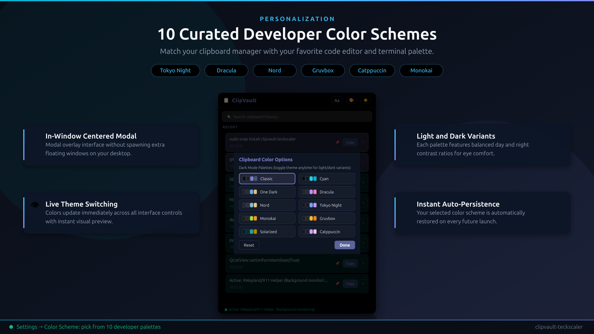
</p>

<p align="center">
  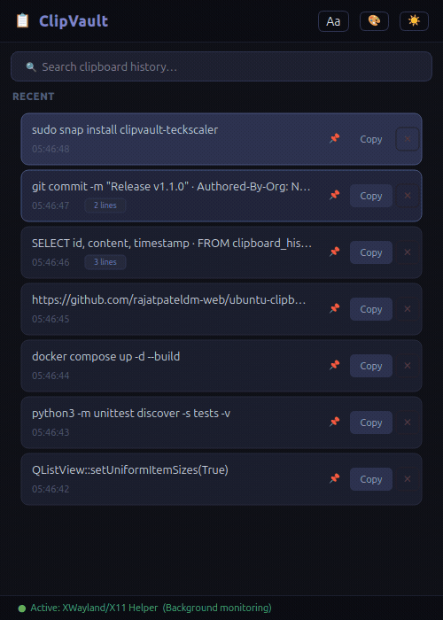
</p>

### Typography Customization and Live Sizing

Configure font family, style, and size with immediate visual feedback. Clipboard cards scale dynamically to maintain clean spacing and button alignment.

<p align="center">
  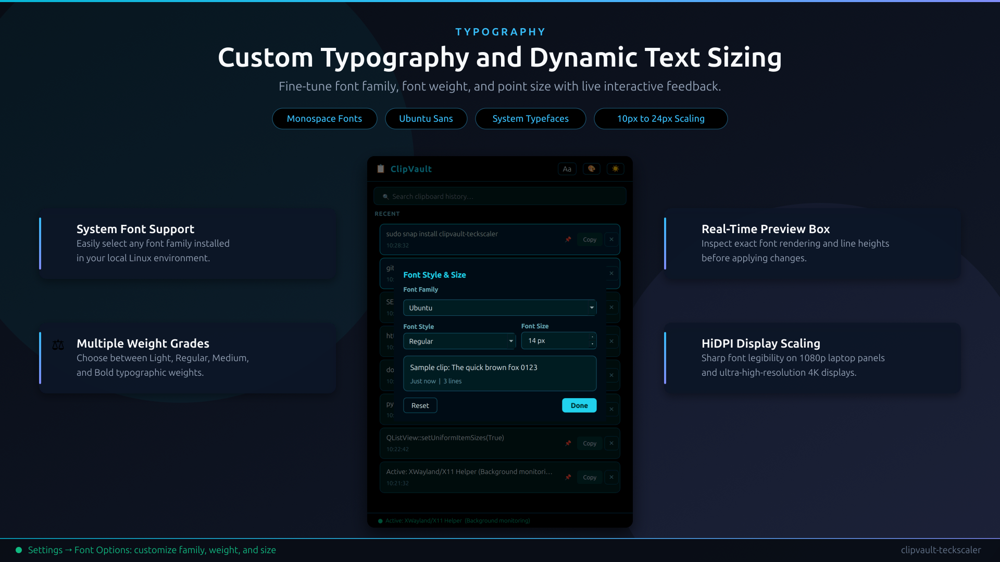
</p>

### Real-Time Search and Virtualized History

Virtualized card presentation renders thousands of clips with constant O(1) memory overhead. Instant case-insensitive substring search filters history without interface lag.

<p align="center">
  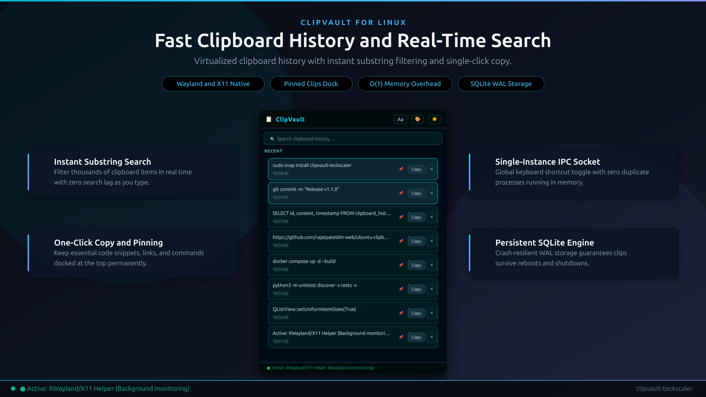
</p>

<p align="center">
  
</p>

### Privacy and Security Architecture

Sensitive credentials copied from password managers are identified through MIME hints and discarded before any text is read into memory or stored on disk.

<p align="center">
  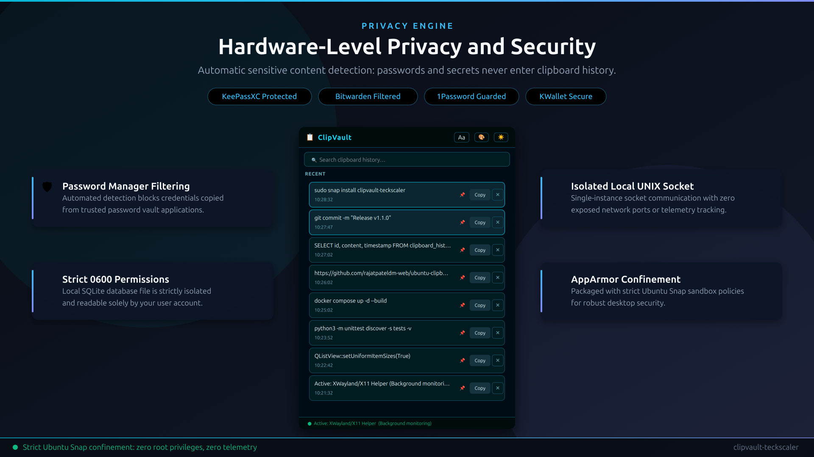
</p>

## Supported Color Palettes

ClipVault v1.1.0 includes ten curated developer palettes. Each palette adapts to both Dark Mode and Light Mode:

| Palette | Aesthetic Style | Accent Highlight | Primary Use Case |
|---|---|---|---|
| **Classic** | Ubuntu Slate and Warm White | Ubuntu Orange (`#e95420`) | Native Ubuntu desktop integration |
| **Cyan** | Deep Midnight Navy and Ice White | Electric Cyan (`#00f0ff`) | High-contrast modern interface |
| **One Dark** | Atom and VS Code Slate | One Dark Blue (`#61afef`) | Software development workstations |
| **Dracula** | Midnight Gothic Purple | Soft Orchid Purple (`#bd93f9`) | Low-light coding environments |
| **Nord** | Arctic Polar Night and Snow Storm | Frost Cyan (`#88c0d0`) | Minimalist cool-toned workspaces |
| **Tokyo Night** | Neon Twilight Indigo | Tokyo Sky Blue (`#7aa2f7`) | Modern terminal setups |
| **Monokai** | Charcoal and Warm Sepia | Monokai Gold (`#e6db74`) | High-legibility code review |
| **Gruvbox** | Earthy Retro Brown and Parchment | Gruvbox Rust (`#fe8019`) | Retro and warm display profiles |
| **Solarized** | Precision Base03 and Warm Base3 | Solarized Cyan (`#2aa198`) | Scientifically tuned contrast |
| **Catppuccin** | Soothing Mocha and Cream Latte | Lavender Purple (`#b4befe`) | Pastel and comfort-focused styling |

## Why ClipVault

- **Pre-read password protection:** Inspects active clipboard targets (`x-kde-passwordManagerHint`, `application/x-password-manager-hint`, `application/x-copyq-secret`, `application/x-nspasteboard-concealed-type`, `text/x-moz-secret`, and related flags) before reading text.
- **No GNOME Wayland dock flicker:** Runs off-thread background capture prioritizing `xclip` and `xsel` before falling back to `wl-paste`, while clearing `DESKTOP_STARTUP_ID` and `XDG_ACTIVATION_TOKEN` on subprocess invocations.
- **Virtualized list rendering:** Uses `QListView` with uniform item sizes and custom `QPainter` delegates with dynamic row heights scaled to the selected font size for smooth scrolling.
- **SQLite WAL persistence (`0600`):** Stores up to 100 unpinned text entries, plus unlimited pinned cards, inside WAL-enabled storage restricted strictly to owner read and write permissions.
- **Three-tier capture engine:** Coordinates Wayland native tools, dedicated X11 and XWayland background polling, and Qt focus fallback for dependable clipboard capture across desktop environments.
- **Strict sandbox ready:** Packaged with `core24` Snap AppArmor confinement, bundled Adwaita icon assets, and single-instance `QLocalServer` UNIX socket toggles.

## Installation

### Snap Store (Ubuntu and Snap-Enabled Linux)

Install the package directly from the Snap Store:

```bash
sudo snap install clipvault-teckscaler --candidate
```

Or install the stable channel release:

```bash
sudo snap install clipvault-teckscaler
```

Other native distribution packages (`Flathub` under `com.teckscaler.ClipVault`, standalone `AppImage`, Debian/Ubuntu `.deb`, `AUR`, and `pipx`) are documented in [DISTRIBUTION_CHECKLIST.md](DISTRIBUTION_CHECKLIST.md).

### Running from Source

To run ClipVault from source on Python 3.12 or newer:

```bash
git clone https://github.com/rajatpateldm-web/ubuntu-clipboard-manager.git
cd ubuntu-clipboard-manager
python3 -m venv venv
source venv/bin/activate
pip install -r requirements.txt
python3 main.py
```

## Global Shortcut Setup (Ubuntu GNOME)

To toggle ClipVault from anywhere using a keyboard shortcut:

1. Open **Settings > Keyboard > Keyboard Shortcuts > View and Customize Shortcuts > Custom Shortcuts**.
2. Click **Add Shortcut**.
3. Set **Name** to `Toggle ClipVault`.
4. Set **Command** to `clipvault-teckscaler.toggle` (or `python3 /path/to/main.py --toggle` when running from source).
5. Set **Shortcut** to `Super + V` (or `Ctrl + Alt + V`).

Pressing the shortcut summons ClipVault instantly. Pressing it again dismisses the window cleanly without modifying clipboard contents.

## Keyboard Controls

- **Type anywhere inside search:** Instant case-insensitive substring filtering across captured clips.
- **`Down` arrow:** Jump directly from the search bar to the first clipboard card.
- **`Enter`:** Copy the selected entry to your active clipboard and dismiss the window.
- **`Delete`:** Remove the selected card (and clear the active system clipboard if it matched).
- **`Escape`:** Dismiss the ClipVault window without altering clipboard state.

## Running Tests Locally

Run the complete test suite locally:

```bash
./test_clipboard.sh
```

The test script runs in an offscreen Qt environment and verifies:

- SQLite WAL persistence, automatic 100-item pruning, and `0o600` owner-only file permissions.
- Pre-read MIME password filtering and negative-flag handling.
- Font customization helpers, family sanitization, style parsing, and dynamic delegate scaling.
- Developer color schemes, stylesheet generation, and live palette switching.
- Persistent X11 and XWayland background clipboard helper process streaming and deduplication.
- Bounded IPC command parsing and single-instance socket communication.
- Virtualized `QListView` model and proxy filtering (`68` automated unit and integration tests plus full end-to-end GUI validation).

## Guides and Architecture Breakdown

- [Official ClipVault Product Page](https://teckscaler.com/clipvault-clipboard-manager/)
- [ClipVault vs. CopyQ on Wayland: Privacy, Memory, and GNOME Stability](https://teckscaler.com/clipvault-vs-copyq-wayland/)
- [Best Clipboard Managers for Ubuntu and Wayland Linux in 2026](https://teckscaler.com/best-linux-clipboard-managers-wayland/)
- [How We Built a Wayland Clipboard Manager in Python and PyQt6 Without GNOME Flicker](https://teckscaler.com/building-wayland-clipboard-manager-python-qt6/)
- [System Architecture Notes](ARCHITECTURE.md)
- [Developer and Contribution Guide](CONTRIBUTING.md)
- [Changelog and Release History](CHANGELOG.md)

## Support and Community

Open bug reports or feature requests on [GitHub Issues](https://github.com/rajatpateldm-web/ubuntu-clipboard-manager/issues) or reach out via the [ClipVault Support Form](https://teckscaler.com/clipvault-clipboard-manager/#support-enquiries).

ClipVault is open source software released under the [MIT License](LICENSE).
