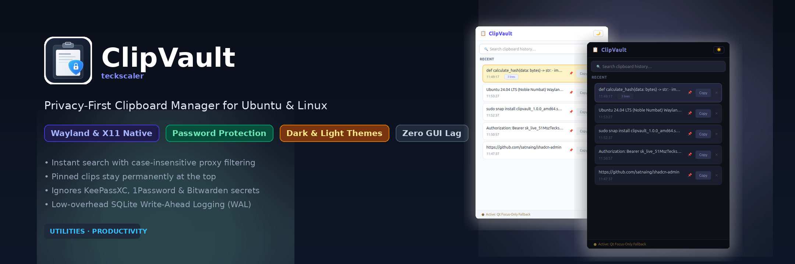
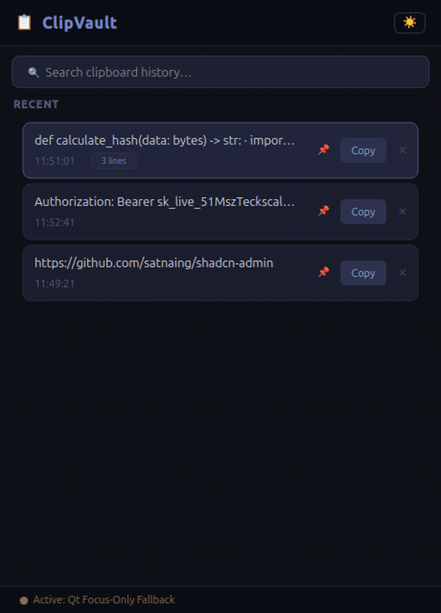
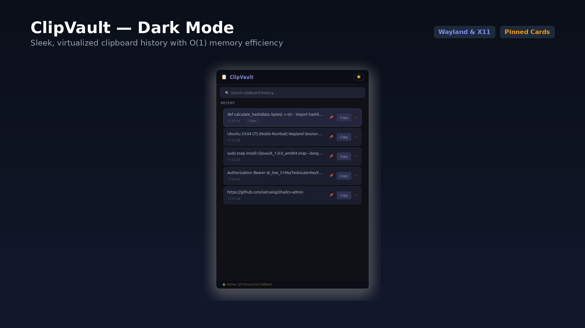
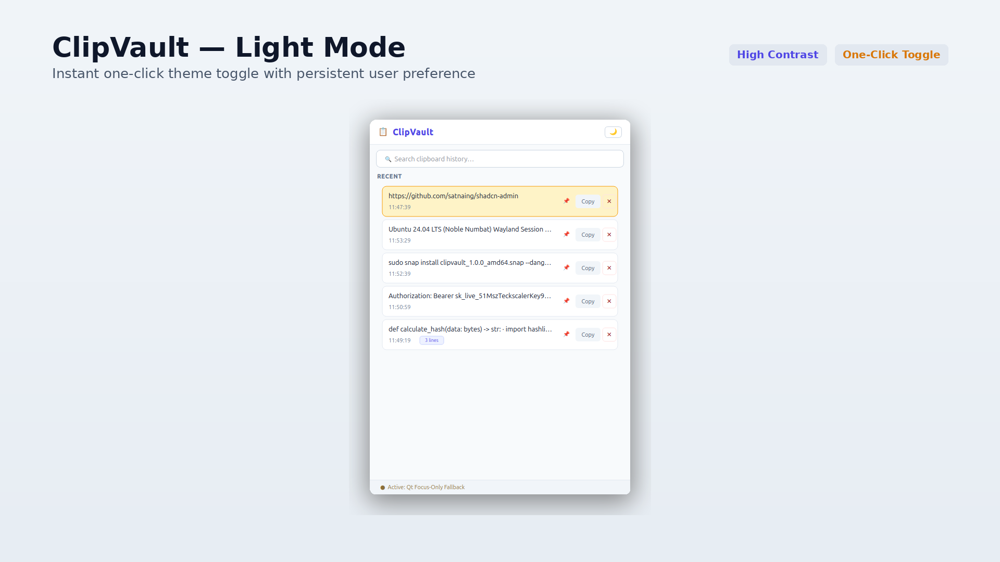

<p align="center">
  
</p>

<h1 align="center">ClipVault</h1>

<p align="center">
  <strong>Privacy-first Linux clipboard manager built with Python and PyQt6 for Wayland and X11.</strong>
</p>

<p align="center">
  <a href="https://snapcraft.io/clipvault-teckscaler"></a>
  <a href="LICENSE"></a>
  <a href="https://teckscaler.com/clipvault-clipboard-manager/"></a>
</p>

ClipVault tracks your text clipboard history on Ubuntu, GNOME Wayland, and X11 desktops without leaking secrets or flickering your dock. Before reading any copied text, it inspects MIME descriptors and discards items flagged by KeePassXC, Bitwarden, 1Password, and KWallet prior to writing to local SQLite WAL storage.

<p align="center">
  
</p>

## Why ClipVault

- **Pre-read password protection:** Inspects active clipboard targets (`x-kde-passwordManagerHint`, `application/x-password-manager-hint`, `application/x-copyq-secret`, `application/x-nspasteboard-concealed-type`, `text/x-moz-secret`, and related flags) before storing text.
- **No GNOME Wayland dock flicker:** Runs off-thread background capture prioritizing `xclip` and `xsel` before falling back to `wl-paste`, while clearing `DESKTOP_STARTUP_ID` and `XDG_ACTIVATION_TOKEN` on subprocess calls.
- **Constant UI memory footprint:** Uses `QListView.setUniformItemSizes(True)` and fixed `64px` custom delegates so scrolling stays smooth regardless of clip size.
- **SQLite WAL persistence (`0600`):** Stores up to 100 unpinned UTF-8 text entries (plus unlimited pinned cards) inside `PRAGMA journal_mode=WAL` storage restricted to owner permissions.
- **Strict sandbox ready:** Packaged with `core24` Snap AppArmor confinement and single-instance `QLocalServer` UNIX socket toggles (`clipvault-teckscaler.toggle`).

## Installation

### Snap Store (Ubuntu and Snap-enabled Linux)

```bash
sudo snap install clipvault-teckscaler --candidate
```

Other native distribution channels (`Flathub` under `com.teckscaler.ClipVault`, standalone `AppImage`, Debian/Ubuntu `.deb`, `AUR`, and `pipx`) are in progress in [DISTRIBUTION_CHECKLIST.md](DISTRIBUTION_CHECKLIST.md).

## Global Shortcut Setup (Ubuntu GNOME)

1. Open **Settings > Keyboard > Keyboard Shortcuts > Custom Shortcuts**.
2. Add a new shortcut named `Toggle ClipVault`.
3. Set the command to `clipvault-teckscaler.toggle`.
4. Bind `Super + V` (or `Ctrl + Alt + V`).

## Keyboard Controls

- **Type anywhere inside search:** Instant case-insensitive substring filtering across captured text.
- **`Down` arrow:** Jump directly from the search bar to the first visible item.
- **`Enter`:** Copy the selected entry to your active clipboard and dismiss the window.
- **`Delete`:** Remove the selected card (and clear active system clipboard if it matched).
- **`Escape`:** Hide ClipVault without altering clipboard state.

## Screenshots

| Dark Mode | Light Mode |
|---|---|
|  |  |

## Guides and Architecture Breakdown

- [Official ClipVault Product Page](https://teckscaler.com/clipvault-clipboard-manager/)
- [ClipVault vs. CopyQ on Wayland: Privacy, Memory, and GNOME Stability](https://teckscaler.com/clipvault-vs-copyq-wayland/)
- [Best Clipboard Managers for Ubuntu and Wayland Linux in 2026](https://teckscaler.com/best-linux-clipboard-managers-wayland/)
- [How We Built a Wayland Clipboard Manager in Python and PyQt6 Without GNOME Flicker](https://teckscaler.com/building-wayland-clipboard-manager-python-qt6/)
- [System Architecture Notes](ARCHITECTURE.md)

## Running Tests Locally

```bash
./test_clipboard.sh
```

The automated test suite verifies SQLite WAL persistence, MIME password filtering across all eight descriptors, negative-flag validation, theme switching, keyboard navigation, and `QListView` virtualization (`40` unit checks plus E2E window checks).

## Reporting Issues and Contributing

Open bug reports or feature requests on [GitHub Issues](https://github.com/rajatpateldm-web/ubuntu-clipboard-manager/issues) or reach us via the [ClipVault Support Form](https://teckscaler.com/clipvault-clipboard-manager/#support-enquiries). Released under the [MIT License](LICENSE).
