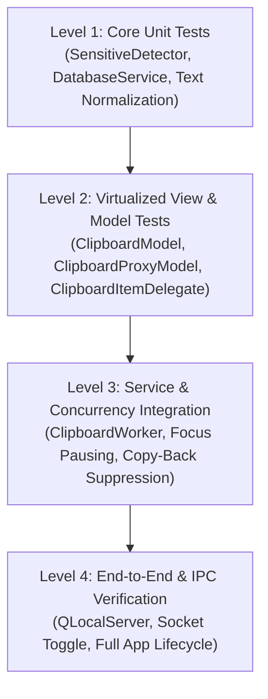

# ClipVault Comprehensive Test Plan

This document establishes the testing strategy, test suites, execution procedures, and verification checklists for ClipVault. It serves as the standard protocol for current development, pull request validation, and future feature expansion.

## 1. Testing Strategy and Philosophy

ClipVault employs a layered testing pyramid designed to ensure performance, desktop environment compatibility, and zero-compromise credential security:

*   **Fast headless execution:** All automated unit, model, and GUI integration tests run headlessly using `QT_QPA_PLATFORM=offscreen` without requiring an active display server or Xvfb wrapper.
*   **Zero data leakage verification:** Sensitive credentials from password managers must be verified at both the detector level and the service capture level to guarantee zero persistence.
*   **Virtualization verification:** Verify that memory consumption and widget counts remain constant regardless of whether the clipboard contains 10 items or 1,000 items.
*   **Desktop environment isolation:** Test Wayland and X11 detection independently through environment variable and subprocess mocking.

## 2. Test Pyramid Overview



## 3. Test Suites and Scope

### Level 1: Core Unit Tests
*   **Text normalization (`services/clipboard_service.py`):**
    *   Converts Windows CRLF (`\r\n`) and Mac CR (`\r`) to Unix LF (`\n`).
    *   Removes null bytes (`\0`) commonly emitted by terminal emulators or CLI pipe utilities.
    *   Strips leading and trailing whitespace while preserving internal structure.
*   **Sensitive detector (`services/sensitive_detector.py`):**
    *   Recognizes all standard password manager MIME formats across KDE, GNOME, macOS, and CopyQ.
    *   Validates case-insensitive target matching.
    *   Respects explicit negative values (`0`, `false`, `no`) to avoid false positives.
    *   Safely handles `None`, empty lists, or malformed target outputs.
*   **Database persistence (`services/database_service.py`):**
    *   Verifies Write-Ahead Logging (`PRAGMA journal_mode=WAL;`).
    *   Tests automatic schema migrations for missing columns (`pinned`).
    *   Tests ordered retrieval (pinned items first, then descending timestamp).
    *   Tests history pruning, ensuring unpinned items are pruned while pinned items remain untouched.
    *   Tests Snap path resolution via `$SNAP_USER_DATA`.

### Level 2: Virtualized Presentation Tests
*   **Data models (`ui/clipboard_model.py`):**
    *   Verifies model insertion, removal, and role retrieval (`ItemIdRole`, `FullTextRole`, `PinnedRole`, `LineCountRole`).
    *   Ensures accurate multiline line counts for preview badges.
    *   Verifies sorting logic: pinned items remain at the top; new unpinned items sort chronologically.
*   **Proxy filtering (`ui/clipboard_model.py`):**
    *   Tests case-insensitive search filtering.
    *   Tests dynamic query clearing and model restoration.
    *   Tests multi-word queries and non-matching queries.
*   **Delegate painting (`ui/clipboard_delegate.py`):**
    *   Verifies fixed card height (64px) for predictable scrolling.
    *   Tests click hit-testing for copy action, pin toggle button, and delete button.

### Level 3: Service Integration Tests
*   **Clipboard worker (`services/clipboard_service.py`):**
    *   Simulates external clipboard polling off the main thread.
    *   Mocks subprocess output from `wl-paste` and `xclip`.
    *   Verifies graceful recovery when external subprocesses exit with non-zero status or missing binaries.
*   **Focus-aware execution:**
    *   Verifies that worker polling pauses when the window gains focus.
    *   Verifies that worker polling resumes when the window loses focus.
*   **Copy-back loop suppression:**
    *   Verifies that copying an item from ClipVault does not generate duplicate capture events.

### Level 4: Headless End-to-End Verification
*   **Single-instance IPC:**
    *   Verifies that launching a second instance sends a `toggle` message and exits cleanly.
    *   Verifies that the primary instance receives the toggle message and toggles window visibility.
    *   Verifies stale local server cleanup on crash recovery.

## 4. Master Test Matrix

| Test ID | Test Category | Component | Test Scenario | Expected Outcome |
| :--- | :--- | :--- | :--- | :--- |
| **SEC-01** | Security | `SensitiveDetector` | Detect `x-kde-passwordManagerHint` in various casings | Format identified as sensitive |
| **SEC-02** | Security | `SensitiveDetector` | Standard MIME types (`text/plain`, `text/html`) | Not flagged as sensitive |
| **SEC-03** | Security | `SensitiveDetector` | Explicit negative value (hint payload is `b"0"`) | Dropped from sensitive classification |
| **SEC-04** | Security | `ClipboardService` | Sensitive clip captured via Tier 1 background worker | Text dropped, zero database insert |
| **SEC-05** | Security | `ClipboardService` | Sensitive clip captured via Tier 3 Qt signal | Text dropped, zero database insert |
| **SEC-06** | Security | `ClipboardService` | Normal clip following a dropped sensitive clip | Normal clip captured cleanly |
| **DAT-01** | Database | `DatabaseService` | Initial database creation | Table created, WAL mode enabled |
| **DAT-02** | Database | `DatabaseService` | Dynamic column migration without `pinned` column | Column added via ALTER TABLE safely |
| **DAT-03** | Database | `DatabaseService` | Insert items with mixed pinned states | Items returned with pinned items first |
| **DAT-04** | Database | `DatabaseService` | Exceed history limit of 100 items | Unpinned items pruned; pinned items kept |
| **DAT-05** | Database | `DatabaseService` | Resolve path inside Snap environment | Database path resides in `$SNAP_USER_DATA` |
| **MOD-01** | Model/View | `ClipboardModel` | Add multiline text with 5 lines | `LineCountRole` returns 5 |
| **MOD-02** | Model/View | `ClipboardModel` | Toggle pin state on middle item | Model re-sorts item to top |
| **MOD-03** | Model/View | `ClipboardModel` | Remove item by ID | Model updates row count and notifies view |
| **PRX-01** | Model/View | `ClipboardProxyModel` | Search query matching single item | Proxy model exposes exactly 1 row |
| **PRX-02** | Model/View | `ClipboardProxyModel` | Non-matching search query | Proxy model exposes 0 rows |
| **PRX-03** | Model/View | `ClipboardProxyModel` | Clear search query | Proxy model restores all rows |
| **DEL-01** | Model/View | `ClipboardItemDelegate` | Query delegate size hint | Fixed 64px height returned |
| **SRV-01** | Service | `ClipboardService` | Window gains focus | Worker polling thread paused (0% CPU) |
| **SRV-02** | Service | `ClipboardService` | Window loses focus | Worker polling thread resumed |
| **SRV-03** | Service | `ClipboardService` | User copies card from history | `_ignore_next` flag set; loop prevented |
| **SRV-04** | Service | `ClipboardWorker` | `wl-paste` exits with return code 1 | Handled cleanly without thread crash |
| **IPC-01** | Integration | `main.py` | Second instance connects to `QLocalServer` | Sends `toggle\n`, primary window toggles |
| **IPC-02** | Integration | `main.py` | Stale socket file exists from previous crash | Stale socket removed; server binds successfully |
| **PER-01** | Performance | `ClipboardModel` | Insert 500 items into model | Memory consumption remains O(1) in viewport |
| **PER-02** | Performance | `ClipboardWorker` | 10 rapid clipboard updates in 500ms | All unique items captured sequentially |
| **THM-01** | UI / Theme | `MainWindow` | Click theme toggle button | Switched between dark and light themes dynamically |
| **THM-02** | UI / Theme | `ClipboardItemDelegate` | Set theme to light mode | Delegate palette switches to light colors and redraws |
| **THM-03** | UI / Theme | `QSettings` | Restart app after selecting light theme | Restores light mode preference automatically |
| **KBD-01** | Usability | `MainWindow` | Press Escape key | Window hides / dismisses immediately |
| **KBD-02** | Usability | `MainWindow` | Press Down Arrow in search field | Focus shifts directly to list view row 0 |
| **KBD-03** | Usability | `MainWindow` | Press Delete on selected item | Highlighted clipboard card deleted from history |

## 5. How to Run Tests

### Running the Full Test Suite
The repository includes an automated test runner script that sets up the environment and executes both unit tests and end-to-end component checks:

```bash
./test_clipboard.sh
```

### Running Unit Tests Directly
To run tests using the active Python virtual environment:

```bash
# Activate the virtual environment
source venv/bin/activate

# Execute all unittest modules headlessly
QT_QPA_PLATFORM=offscreen python -m unittest discover -s tests -v
```

### Running a Specific Test File or Class
```bash
# Run sensitive detector unit tests
QT_QPA_PLATFORM=offscreen python -m unittest tests/test_sensitive_detector.py -v

# Run virtualized view and model tests
QT_QPA_PLATFORM=offscreen python -m unittest tests/test_virtualized_view.py -v

# Run database tests
QT_QPA_PLATFORM=offscreen python -m unittest tests/test_database_service.py -v
```

## 6. Continuous Integration (CI/CD) Pipeline Specification

Future automated CI pipelines (GitHub Actions, GitLab CI) must run against Ubuntu 22.04 and Ubuntu 24.04 runners using this reference workflow:

```yaml
name: Test Suite

on:
  push:
    branches: [ main, development ]
  pull_request:
    branches: [ main, development ]

jobs:
  test:
    runs-on: ubuntu-24.04
    steps:
      - name: Checkout Code
        uses: actions/checkout@v4

      - name: Set up Python
        uses: actions/setup-python@v5
        with:
          python-version: '3.12'
          cache: 'pip'

      - name: Install System Dependencies
        run: |
          sudo apt-get update
          sudo apt-get install -y libgl1 libegl1 libxkbcommon-x11-0 libdbus-1-3 wl-clipboard xclip

      - name: Install Python Dependencies
        run: |
          python -m pip install --upgrade pip
          pip install -r requirements.txt

      - name: Run Headless Test Suite
        env:
          QT_QPA_PLATFORM: offscreen
        run: |
          python -m unittest discover -s tests -v

      - name: Run E2E Integration Verification
        env:
          QT_QPA_PLATFORM: offscreen
        run: |
          ./test_clipboard.sh
```

## 7. Guidelines for Writing New Tests

Future contributors adding new features or fixing defects must follow these standards:

### 1. Test-Driven Development (TDD)
Write a failing test case before implementing features or resolving bugs. Confirm that the test fails for the expected reason before adding implementation code.

### 2. Isolate State Between Tests
*   Never use the default `clipvault.db` file in tests. Use `tempfile.NamedTemporaryFile` or custom paths inside `setUp()` and delete them inside `tearDown()`.
*   Clean up `QApplication` instances properly or use the shared `QApplication.instance()` helper.

### 3. Mock External System Binaries
*   When testing clipboard capture logic, mock `subprocess.run` responses rather than invoking actual system binaries (`wl-paste`, `xclip`). This ensures tests remain deterministic regardless of host OS configurations.
*   Test failure branches explicitly, including `subprocess.CalledProcessError`, `FileNotFoundError`, and timeout exceptions.

### 4. Verify Virtualization Integrity
When adding UI components or card capabilities (such as action buttons or preview badges), verify that changes do not bypass `ClipboardItemDelegate` in favor of instantiating heavy `QWidget` hierarchies inside list rows.

